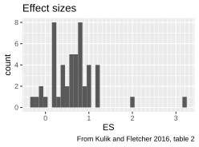

# AI tutors

> ES: Glass's estimator of effect size.
> Note that this study compares **lecturing** with AI tutoring

There was no significant difference between AI tutors
and small-group collaborative instruction ($g = 0.05$)
or individualized human tutoring ($g = -0.11$)
[Wenting, 2014].
Also, skilled human active instruction remained slightly superior
($d = 0.79$ vs. $d = 0.76\text{--}0.71$)
[Steenbergen‐Hu, 2013][VanLehn, 2011].

## References

- `[Kestin et al., 2025]`
  Kestin, G., Miller, K., Klales, A. et al.
  AI tutoring outperforms in-class active learning:
  an RCT introducing a novel research-based design in an authentic
  educational setting. Sci Rep 15, 17458 (2025).
  <https://doi.org/10.1038/s41598-025-97652-6>

- `[Kulik and Fletcher, 2016]` Kulik, James A., and John D. Fletcher. 
  "Effectiveness of intelligent tutoring systems: A meta-analytic review."
  Review of educational research 86.1 (2016): 42-78.
  [DOI](https://journals.sagepub.com/doi/10.3102/0034654315581420)
