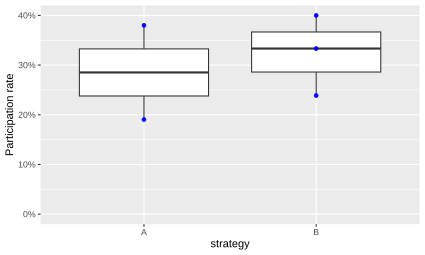

# Email contact to increase attendance

Research question: can increase email contact increase attendance for free
online courses?

## Experiment 1: Bianca intermediate

From [the 'Bianca course' data](https://uppmax.github.io/bianca_workshops/data/),
focusing on the intermediate course, we see:

Course      |Iteration |Course date|Registered|Showing up|Attendance
------------|----------|-----------|----------|----------|----------
Intermediate|1         |2023-12-11 |?         |12        |.
Intermediate|2         |2024-05-24 |?         |5         |.
Intermediate|3         |2024-11-11 |?         |6         |.
Intermediate|4         |2025-05-22 |3         |3         |100%
Intermediate|5         |2025-11-18 |7         |2         |29%
Intermediate|6         |2026-05-22 |16        |4         |25%

At 2026-10-14 this will be the new communication strategy:

Email text                                |When                     |What should be in the email                                     |Goal of email
------------------------------------------|-------------------------|----------------------------------------------------------------|----------------------------------------------------------------------
[Email text](registration_confirmation.md)|Short after registration |Confirmation, event value, date/time in local zone, calendar add|Early contact closes the commitment gap `[Abdolrasulnia et al., 2004]`
[Email text](reminder_1_week.md)          |1 week before session    |Simple reminder to prepare                                      |Learners need to be prepared
[Email text](reminder_1_day.md)           |1 day before session     |Simple reminder with link and clear message what to do          |Most webinar users prefer this timing  `[Almuzian et al, 2022]`
[Email text](reminder_1_hour.md)          |1 hour before session    |Very short reminder with join link                              |Many users want a last-minute prompt  `[Almuzian et al, 2022]`

We will keep track of attendance rate

## Experiment 2: HPC Python

Have we ever seen an effect?

Checking
[the 'HPC Python Day 1' communication](https://uppmax.github.io/naiss_intro_python/communication/)
and [the 'HPC Python Day 1' data](https://uppmax.github.io/naiss_intro_python/data/)
we see:

No |Date      |Strategy|Registrations|Participants|Attendance
---|----------|--------|-------------|------------|----------
3  |2025-03-04|B       |67           |16          |24%
5  |2025-10-14|B       |30           |12          |40%
6  |2025-11-27|A       |42           |8           |19%
7  |2026-03-03|B       |57           |19          |33%
8  |2026-04-20|A       |50           |19          |38%

- Strategy `A`: sufficient
- Strategy `B`: more effort

The data, being very limited, shows no significant difference:

## References

- `[Abdolrasulnia et al., 2004]` Abdolrasulnia, M., Collins, B. C., Casebeer, L., Wall, T., Spettell, C., Ray, M. N., Weissman, N., Allison, J., C., E., Edu, C., Edu, N. W., & Allison, J. Bmc Medical Education Using Email Reminders to Engage Physicians in an Internet-based Cme Intervention.
- `[Almuzian et al, 2022]` Almuzian, M., Mheissen, S., Wertheimer, M., & Khan, H. (2022). Global survey to assess preferences for attending virtual orthodontic learning sessions: Pre-webinar settings. Journal of Orthodontics, 50, 157 - 165. <https://doi.org/10.1177/14653125221124622>
